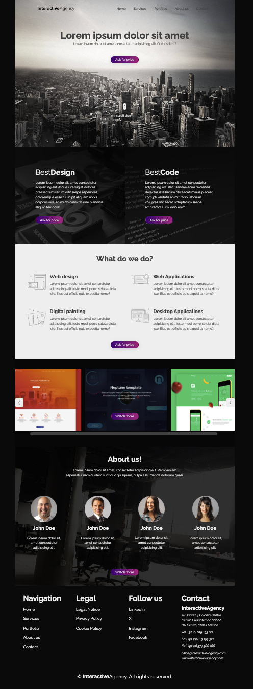
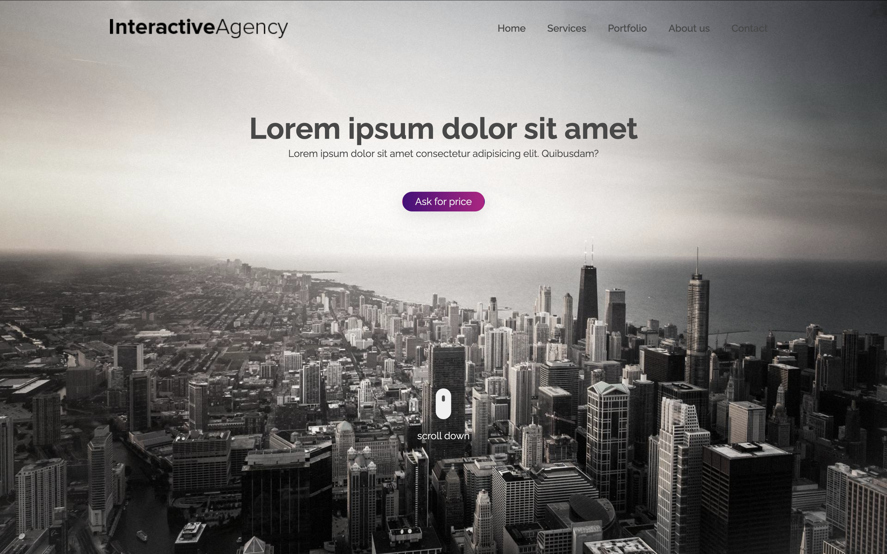

# InteractiveAgency — A Landing Page Project

A responsive landing page built with HTML5 and CSS3.

**1. Full Page Preview:**

<div align="center">
    
</div>

**2. Hero Section Preview:**

<div align="center">
    
</div>

## Live Demo

[View the live website](https://habidbesp.github.io/Landing-page---InteractiveAgency/)

## Overview

**InteractiveAgency** is a landing page project built with HTML5 and CSS3, based on an original PSD design by Symu.

The project focuses on recreating the original design while implementing a responsive layout using semantic HTML, Flexbox, and CSS Media Queries.

## Features

- Semantic HTML structure
- Responsive layout
- Desktop-first CSS approach
- Flexbox-based layouts
- Mobile navigation menu

## Technologies

- HTML5
- CSS3
- Flexbox
- Media Queries

## Project Structure

```
Landing-page---InteractiveAgency/
├── assets
├── index.html
├── style.css
├── media-queries.css
└── README.md
```

## What I Learned

- Structuring web pages using semantic HTML5 elements.
- Building layouts with CSS Flexbox.
- Implementing responsive designs using CSS Media Queries.
- Working with relative CSS units and managing image dimensions.

## Getting Started

**1. Clone the repository:**

```bash
git clone https://github.com/habidbesp/Landing-page---InteractiveAgency.git
```

**2. Navigate to the project directory:**

```bash
cd Landing-page---InteractiveAgency
```

**3. Open index.html in your browser.**

## Author

**Habid Badillo Espinosa**

[GitHub](https://github.com/habidbesp)

## Responsive Preview

Check how the landing page adapts to different screen sizes using [Am I Responsive?](https://fireship.dev/amiresponsive?url=https://habidbesp.github.io/Landing-page---InteractiveAgency/).

## Credits

- **Original design:** [Interactive Agency — PSD Template](https://symu.co/freebies/templates-4/interactive-agency-psd-template/) by Symu.
- **Implementation:** Recreated from the original design using HTML5 and CSS3.
